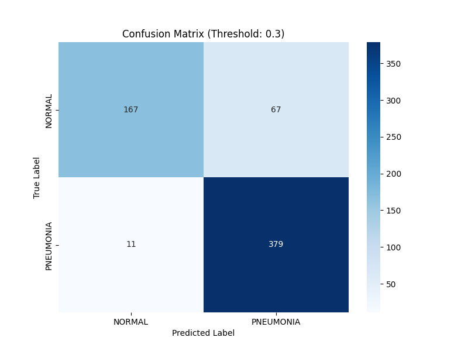
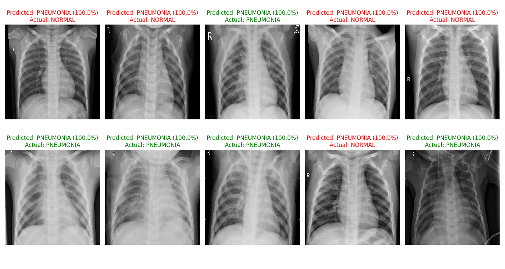

# Pneumonia Detection CNN

A project for CECS 456 (Machine Learning) at California State University, Long Beach. I built and trained a convolutional neural network (CNN) to classify pediatric chest X-rays as **NORMAL** or **PNEUMONIA**.

## How it works

- **Input:** Chest X-rays resized to 150 × 150 pixels in grayscale, with pixel values rescaled to 0–1.
- **Model:** Five convolutional blocks with batch normalization and max pooling, followed by a dense layer and a sigmoid output.
- **Training:** Image augmentation (flips, rotations, and zooms), dropout, early stopping, and learning-rate reduction to help limit overfitting.
- **Evaluation:** A classification threshold of **0.30** was used to prioritize detecting pneumonia cases, with the tradeoff of more false positives.

The project uses Python, Keras/TensorFlow, NumPy, Matplotlib, Seaborn, and Scikit-Learn.

## Results

The saved confusion matrix shows these results on **624 test images** at the 0.30 threshold:

| Metric | Result |
| --- | ---: |
| Accuracy | 87.5% (546 / 624) |
| Pneumonia recall | 97.2% (379 / 390) |
| Missed pneumonia cases | 11 |
| Normal images flagged as pneumonia | 67 |



Sample predictions from the test set:



These results are from a course project, not a clinically validated diagnostic system. The provided validation split is also small, so performance may not generalize to other datasets.

## Running the project

1. Download the [Chest X-Ray Images (Pneumonia) dataset](https://www.kaggle.com/datasets/paultimothymooney/chest-xray-pneumonia/data) from Kaggle.
2. Extract it under `data/`, keeping the original `train/`, `val/`, and `test/` folders. Each should contain `NORMAL/` and `PNEUMONIA/` subfolders.
3. Use Python 3.11 and install the dependencies:

   ```bash
   pip install tensorflow numpy matplotlib seaborn scikit-learn
   ```

4. Run the scripts:

   ```bash
   python main.py            # Train and save the model
   python evaluate_model.py  # Print metrics and save a confusion matrix
   python predict.py         # Show and save sample predictions
   ```

The dataset and trained model files are not included in the repository. Train the model first to create the model files in `models/`.

## Files

- `main.py` — Model architecture and training loop
- `evaluate_model.py` — Classification report and confusion matrix
- `predict.py` — Sample predictions and visualization
- `results/` — Saved evaluation images
- [`Report.pdf`](Report.pdf) — Full course project report
